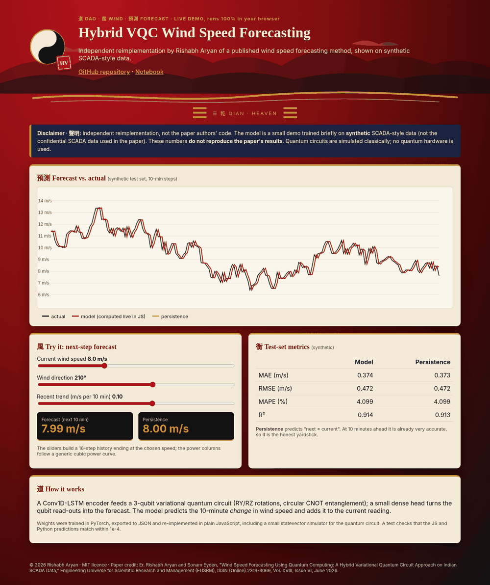

<p align="center"></p>

# Hybrid Variational Quantum Circuit (HVQC) for Wind Speed Forecasting: PyTorch + PennyLane Reimplementation

[](https://rishabh-bgp.github.io/hybrid-vqc-wind-speed-forecasting/) [](https://colab.research.google.com/github/Rishabh-bgp/hybrid-vqc-wind-speed-forecasting/blob/main/notebooks/hybrid-vqc-wind-speed-forecasting_walkthrough.ipynb)

> **Independent reimplementation.** This repository is a clean, independent reimplementation of the method described in the
> paper cited below, written from the paper's text. It is **not** the original authors' code, and it does **not** use the
> paper's dataset. All quantum components run **on a classical simulator only** (PennyLane `default.qubit`, CPU, 4 qubits, 2 layers by default; the paper uses 8 qubits and 4 layers).
> Results from this code **will differ** from the published results, and the numbers reported in the paper have **not** been reproduced here.

**Keywords:** wind speed forecasting, quantum machine learning, variational quantum circuit, hybrid quantum-classical, Conv1D-LSTM, SCADA, PennyLane, PyTorch, renewable energy

## Paper · 論文

Er. Rishabh Aryan and Sonam Eyden, "Wind Speed Forecasting Using Quantum Computing: A Hybrid Variational Quantum Circuit Approach on Indian SCADA Data," *Engineering Universe for Scientific Research and Management (EUSRM)*, ISSN (Online) 2319-3069, Vol. XVIII, Issue VI, June 2026.

Full credit for the method goes to the paper's authors. Any simplifications or mistakes in this reimplementation are mine.

## Method · 方法

1. **Classical Encoding Module (CEM):** a Conv1D layer and an LSTM summarise a 24-step multivariate window of SCADA features.
2. **Variational Quantum Circuit:** the encoding is projected to one angle per qubit (`tanh·π/2`), angle-encoded with RY, then passed through layers of trainable RY/RZ rotations with circular CNOT entanglement. The output is the Pauli-Z expectation ⟨Z⟩ of each qubit.
3. **Classical Regression Head (CRH):** a small dense network maps the ⟨Z⟩ vector to the wind speed forecast.
4. **Two-phase training:** phase 1 freezes the quantum weights and warms up the classical parts; phase 2 trains everything jointly with Adam. This mirrors the paper's barren-plateau mitigation. Gradients come from simulator backpropagation; the paper's parameter-shift/SPSA option is not implemented.

## Architecture · 架構

```
window (B,24,5) → Conv1D(5→32,k=3)+ReLU → LSTM(32) → Linear(32→Q) → tanh·π/2
  → VQC[RY enc → L×(RY,RZ per qubit → circular CNOT)] → ⟨Z⟩ (Q) → Dense(Q→16→1) → ŷ
```

## Data · 數據

The original SCADA data used in the paper is confidential and **not publicly available**, so it is not included here (everything in `data/` except the bundled synthetic CSV is git-ignored). The original code was not available either.
`src/data.py` provides:

- `load_scada_csv(path)`: loads a SCADA-style CSV with columns for timestamp, wind speed (m/s), wind direction (°),
  theoretical power and active power. It accepts both snake_case names (`timestamp, wind_speed, wind_direction,
  theoretical_power, active_power`) and the common Kaggle-style headers
  (`Date/Time, LV ActivePower (kW), Wind Speed (m/s), Theoretical_Power_Curve (KWh), Wind Direction (°)`).
- `synthetic_scada(n)`: an offline synthetic fallback (diurnal + weekly cycles, AR(1) turbulence, a cubic power curve and
  noisy active power). It is generated by script, so no download or account is needed:
  `python scripts/make_synthetic.py --n 3000`.

**Bundled synthetic dataset:** `data/synthetic/synthetic_scada.csv` (1500 rows, 10-minute steps, seed 0) is **synthetic data generated by `scripts/make_synthetic.py`**. It is **not** the confidential SCADA data used in the paper and has no connection to any real wind farm. `train.py` uses it by default. To use your own data locally, pass `--csv path/to/scada.csv`. Anything else you put in `data/` is git-ignored, so real data is never committed.

Features per time step are wind speed, sin/cos of direction, theoretical power and active power (kW/1000), standardised
on the training split. The target is wind speed `horizon` steps ahead. The data is split chronologically 70/15/15.

## How to run · 運行

```bash
python -m venv .venv && source .venv/bin/activate
pip install -r requirements.txt

# quick smoke test on the built-in synthetic data
python train.py --epochs 2

# full run on your own SCADA-style CSV
python train.py --csv path/to/scada.csv --epochs 30 --qubits 8 --layers 4
```

The script prints and saves (`results/*_metrics.json`) **MAE, RMSE, MAPE and R²** on the chronological test split, plus a
naive persistence baseline for comparison. MAPE uses a 0.5 m/s floor in the denominator so calm periods don't blow it up.

## Smoke-test results (synthetic data only) · 測試

These come from a deliberately tiny run (2 epochs, 1,500 synthetic 10-minute rows, 4 qubits, seed 42) on **synthetic data**, just to check that the pipeline works
end to end. They say nothing about the method's real accuracy. At this budget the model has not converged and is **worse than persistence**.

| Metric | Model | Persistence |
|---|---|---|
| MAE | 1.580 | 0.375 |
| RMSE | 2.043 | 0.474 |
| MAPE (%) | 15.194 | 4.106 |
| R² | -0.629 | 0.912 |

## Live demo · 演示

**[https://rishabh-bgp.github.io/hybrid-vqc-wind-speed-forecasting/](https://rishabh-bgp.github.io/hybrid-vqc-wind-speed-forecasting/)** runs entirely in your browser. A small version of the model (trained briefly on the bundled synthetic CSV to predict the 10-minute change in wind speed) is exported to JSON by `web/export_model.py`, and its forward pass is re-implemented in plain JavaScript (`site/model.js`), including a small statevector simulator for the quantum circuit. `tests/test_js_parity.py` checks that the JS and PyTorch predictions agree within 1e-4. The page shows a forecast chart against persistence, sliders for wind inputs, the metrics and the disclaimer.



## Notebook · 筆記本

[`notebooks/hybrid-vqc-wind-speed-forecasting_walkthrough.ipynb`](notebooks/hybrid-vqc-wind-speed-forecasting_walkthrough.ipynb) [](https://colab.research.google.com/github/Rishabh-bgp/hybrid-vqc-wind-speed-forecasting/blob/main/notebooks/hybrid-vqc-wind-speed-forecasting_walkthrough.ipynb) is a short, beginner-friendly walkthrough: load the synthetic CSV, quick EDA plots, a small version of the model, brief training and a comparison with a persistence baseline. It works when opened on its own in Colab (it fetches the repo code and data). It uses **synthetic data only** and does **not** reproduce the paper's results.

## Tests · 測試

```bash
pytest -q
```

## Repository layout · 結構

```
├── train.py              # train + evaluate (MAE/RMSE/MAPE/R²)
├── scripts/make_synthetic.py
├── src/
│   ├── data.py           # SCADA CSV loader, synthetic generator, windowing
│   ├── metrics.py
│   ├── qlayer.py         # simulator-only VQC (PennyLane)
│   ├── train_common.py
│   └── hvqc.py
├── requirements.txt  LICENSE  .gitignore
```

## Limitations · 局限

- Only one-step-ahead forecasting is set up by default (`--horizon` changes it).
- The paper's NTPC Jaisalmer data and baseline suite are not included.
- Simulated quantum circuits scale exponentially with qubit count, so the defaults use few qubits. Larger settings will be slow on CPU.

## Licence · 許可

MIT © 2026 Rishabh Aryan. See [LICENSE](LICENSE). The paper itself remains under its publisher's terms.

## Other repositories by Rishabh Aryan · 其他

- [beed-ml-study](https://github.com/Rishabh-bgp/beed-ml-study)
- [pan-cancer-classification](https://github.com/Rishabh-bgp/pan-cancer-classification)
- [spam-scan](https://github.com/Rishabh-bgp/spam-scan)
- [real-estate-valuation-taiwan](https://github.com/Rishabh-bgp/real-estate-valuation-taiwan)
- [boston-house-price-prediction](https://github.com/Rishabh-bgp/boston-house-price-prediction)
- [california-house-price-prediction](https://github.com/Rishabh-bgp/california-house-price-prediction)
- [iris-classification](https://github.com/Rishabh-bgp/iris-classification)
- [machine-learning-part-1](https://github.com/Rishabh-bgp/machine-learning-part-1)
- [All repositories](https://github.com/Rishabh-bgp?tab=repositories)
